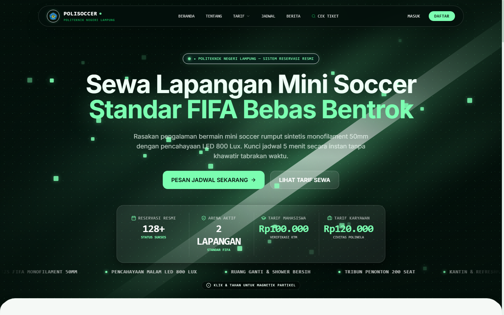
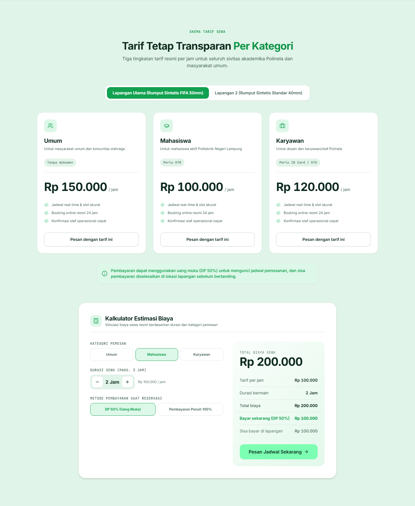
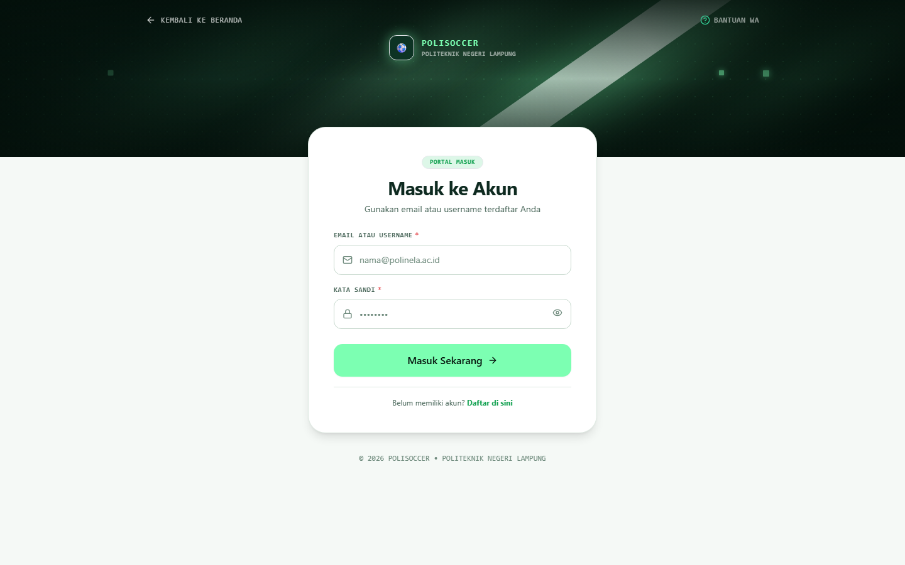
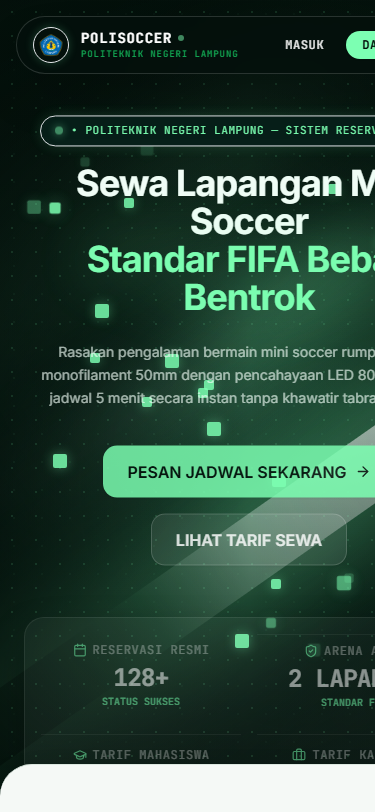
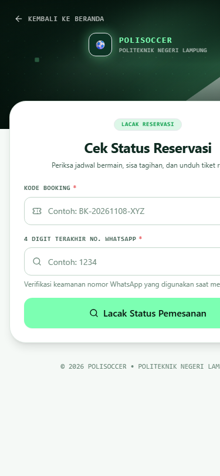

<div align="center">

# ⚽ POLISOCCER

### Sistem reservasi dan pengelolaan lapangan mini soccer

Platform digital untuk pemesanan lapangan, pembayaran, jadwal, dan operasional
Mini Soccer **Politeknik Negeri Lampung** — dalam satu pengalaman yang modern.

<br />


<br />

[Mulai](#-mulai) · [Fitur](#-fitur-utama) · [Teknologi](#-teknologi) · [Keamanan](#-keamanan-dan-keandalan)

</div>

<br />

<div align="center">
  
  <br />
  <sub>Landing page POLISOCCER · antarmuka dark green dengan aksen neon mint</sub>
</div>

## ✨ Tentang proyek

**POLISOCCER** adalah aplikasi reservasi dan manajemen fasilitas mini soccer Politeknik Negeri Lampung. Pengguna dapat melihat ketersediaan jadwal, memesan beberapa jam sekaligus, mengunggah bukti pembayaran, dan mengakses e-tiket. Tim operasional mengelola reservasi, tarif, berita, serta aktivitas lapangan melalui dashboard sesuai peran.

Antarmuka mengusung tema **dark green + neon mint** (`#7CFFB2`) dengan panel terang, tata letak responsif, dan komponen interaktif.

## 🚀 Fitur utama

| Area | Yang tersedia |
|---|---|
| **Halaman publik** | Informasi lapangan, tarif dan simulasi biaya, kalender ketersediaan, berita, galeri, serta cek status tiket. |
| **Dashboard pengguna** | Pemesanan bertahap, pemilihan beberapa slot berurutan, pembayaran DP atau lunas, unggah bukti transfer, riwayat, profil, dan e-tiket QR. |
| **Dashboard admin** | Ringkasan operasional, verifikasi pembayaran dan identitas, pengelolaan reservasi, jadwal, berita, pengguna, serta booking manual. |
| **Dashboard super admin** | Manajemen akun dan lapangan, tarif, pengaturan sistem, laporan, serta audit aktivitas. |

### Alur pemesanan

**Pilih jadwal** → **Kunci slot sementara** → **Bayar DP atau lunas** → **Terima e-tiket**

## 🧰 Teknologi

| Bagian | Teknologi |
|---|---|
| Frontend | React 18, Vite, Tailwind CSS, React Router |
| Interaksi & visualisasi | Framer Motion, Three.js, Recharts, Lucide |
| Backend | Node.js, Express |
| Database | MySQL / MariaDB, Sequelize |
| Autentikasi & upload | JWT, bcryptjs, Multer |

## 📁 Struktur proyek

```text
polisoccer/
├── backend/       # REST API, model, route, dan layanan
├── database/      # Inisialisasi, migrasi, dan seeder
├── frontend/      # Aplikasi React + Vite
├── screenshots/   # Dokumentasi tampilan aplikasi
├── start-all.bat  # Menjalankan seluruh layanan di Windows
└── README.md
```

## 🖥️ Mulai

### Prasyarat

- Windows dengan **Node.js dan npm**
- **XAMPP MySQL** atau layanan MySQL/MariaDB lain pada port `3306`

### Cara cepat — Windows

1. Pastikan MySQL aktif.
2. Jalankan `start-all.bat` dari folder proyek.
3. Buka [http://localhost:3000](http://localhost:3000).

Launcher akan menyiapkan file konfigurasi backend bila belum tersedia, memasang dependensi yang belum ada, menjalankan migrasi, lalu membuka frontend dan backend pada jendela terminal terpisah.

### Menjalankan manual

1. Siapkan konfigurasi backend:

   ```powershell
   Copy-Item backend\.env.example backend\.env
   ```

   Sesuaikan koneksi database dan nilai konfigurasi lain di `backend\.env`. Jangan gunakan kredensial bawaan untuk deployment.

2. Pasang dependensi dan jalankan migrasi dari root proyek:

   ```powershell
   cd backend
   npm install
   cd ..
   node database\migrate.js
   ```

3. Di terminal pertama, jalankan backend:

   ```powershell
   cd backend
   npm start
   ```

4. Di terminal kedua, jalankan frontend:

   ```powershell
   cd frontend
   npm install
   npm run dev
   ```

   Frontend tersedia di [http://localhost:3000](http://localhost:3000), sedangkan API berjalan di [http://localhost:5000](http://localhost:5000).

> **Data demo:** Jika membutuhkan akun dan data awal untuk pengembangan, tinjau `database\seed_fase2.js` sebelum menjalankannya. Kredensial seed hanya untuk lingkungan lokal; ganti dan amankan semua kredensial sebelum aplikasi digunakan di lingkungan lain.

## 🔒 Keamanan dan keandalan

- **Perlindungan bentrok jadwal:** slot aktif menggunakan unique constraint di database, sementara proses reservasi berjalan dalam transaksi.
- **Kunci slot sementara:** slot yang dipilih ditahan selama 5 menit; cron job membersihkan lock kedaluwarsa setiap menit.
- **Validasi harga di backend:** perhitungan harga dilakukan di sisi server, bukan mempercayai nilai dari browser.
- **Upload terkontrol:** file diperiksa berdasarkan tipe konten, dibatasi ukurannya, dan disimpan dengan nama acak. Dokumen privat hanya diakses melalui endpoint terautentikasi.
- **Konfigurasi lokal:** simpan rahasia di `backend\.env` dan jangan unggah file tersebut ke repositori.

## 🖼️ Galeri

Beberapa tampilan aplikasi:

<div align="center">
  
  
  <br />
  
  
</div>

<br />

<div align="center">
  <sub>Dibuat untuk mendukung layanan Mini Soccer Politeknik Negeri Lampung.</sub>
</div>
